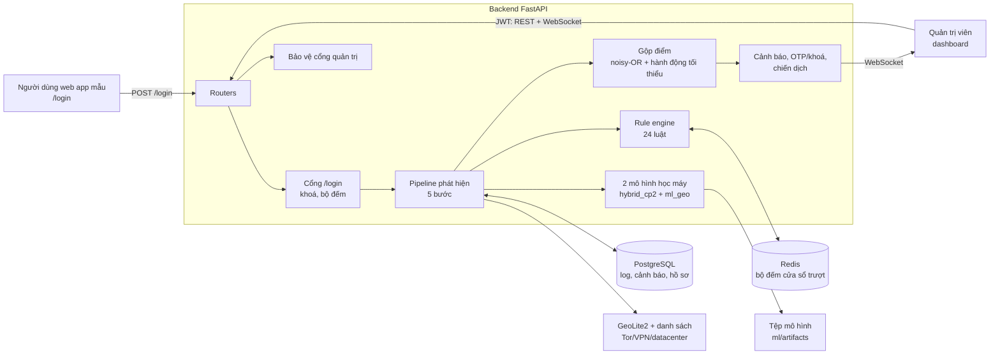
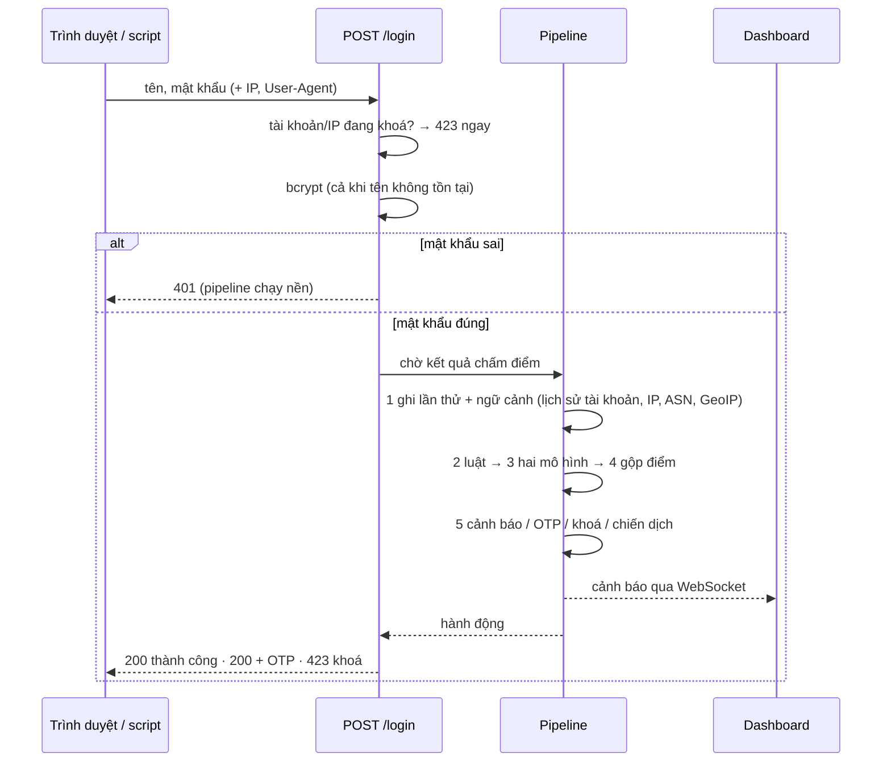

# Kiến trúc hệ thống (bản hiện hành, cập nhật MR35)

Tài liệu này mô tả hệ thống **như đang chạy**. Các tài liệu theo từng MR (`docs/README.md` mục "Lịch sử") ghi lại vì sao đi tới thiết
kế này và số đo tại thời điểm đó.

## 1. Thành phần



| Thành phần | Mã | Vai trò |
|---|---|---|
| Frontend | `frontend/src/` (React + Vite) | Web app mẫu `/login` (đối tượng bị giám sát, có bước OTP); khu quản trị: dashboard real-time (bản đồ, biểu đồ điểm, log, cảnh báo, khoá, nhật ký đăng nhập quản trị), Chiến dịch, Luật, Sức khoẻ mô hình, Hồ sơ tài khoản |
| Routers | `backend/app/routers/` | 18 endpoint — [`api-contract.md`](api-contract.md) |
| Cổng `/login` | `app/routers/auth.py`, `app/detection/gate.py` | Từ chối ngay tài khoản/IP đang khoá (trước cả kiểm mật khẩu); bcrypt chạy cả với tên không tồn tại; ghi lần bị từ chối và lần sai OTP vào bộ đếm của luật |
| Pipeline | `app/detection/pipeline.py` | 5 bước cho MỖI lần thử (mục 2) |
| Rule engine | `app/detection/engine/` | 24 luật trong 4 nhóm, cửa sổ thời gian trên Redis; bật/tắt, chỉnh ngưỡng lúc chạy — [`rule-catalog.md`](rule-catalog.md) (tự sinh từ mã) |
| Mô hình | `app/detection/hybrid_runtime.py`, `ml_model.py` | `hybrid_cp2` và mô hình địa lý–thời gian (mục 3) |
| Gộp điểm | `app/detection/hybrid/` | Một điểm 0–100, một hành động (mục 4) |
| Sau chấm điểm | `alert_intelligence.py`, `response_execution.py`, `campaign_correlation.py`, `adaptive_threshold.py` | Một sự cố = một cảnh báo; OTP/khoá tạm; gom chiến dịch theo IP/ASN; ngưỡng riêng từng tài khoản học từ phản hồi |
| Bảo vệ cổng quản trị | `app/admin_guard.py` | Giới hạn theo IP và theo tài khoản (khoá thông minh tách IP quen/lạ), ghi vết — [`security-review.md`](security-review.md) |
| Dữ liệu | PostgreSQL (15 bảng, [`db-schema.md`](db-schema.md)), Redis (bộ đếm luật), GeoLite2, `backend/threat_intel/` | |
| Ngoại tuyến | `backend/ml/rba/`, `ml/corpus/`, `ml/lanl/` | Huấn luyện/hiệu chỉnh trên RBA; bộ kịch bản có nhãn 39 họ để hiệu chỉnh và đo; kiểm chứng trên log thật LANL |

## 2. Một lần đăng nhập đi qua hệ thống



Năm bước (`pipeline.py`), mỗi bước cô lập lỗi bằng SAVEPOINT — một bước hỏng không làm mất lần thử đã ghi:

1. **Ghi lần thử và dựng ngữ cảnh** một lần (`login_context.py`): lịch sử tài khoản, thống kê IP/ASN 24 giờ, GeoIP, ASN, phân tích
   User-Agent. Luật, đặc trưng mô hình và giải thích dùng chung ngữ cảnh này.
2. **Luật**: mọi luật đang bật chấm lần thử; luật khớp là **bằng chứng có trọng số**.
3. **Mô hình**: `hybrid_cp2` cho mọi lần thử; mô hình địa lý–thời gian chỉ cho tài khoản đã có ≥ 5 lần đăng nhập thành công (cổng
   cold-start), bỏ qua lần đăng nhập lại cùng IP + thiết bị trong 30 phút (cùng phiên).
4. **Gộp điểm** (mục 4) theo ngưỡng của nhóm hoặc ngưỡng riêng của tài khoản (học từ phản hồi "Đúng/Báo nhầm").
5. **Hành động**: hành động khác "cho qua" tạo hoặc cập nhật MỘT cảnh báo cho sự cố (các lần thử liên tiếp ≤ 15 phút gộp lại), kèm họ
   tấn công gợi ý, độ ưu tiên và danh sách bằng chứng; `step_up` → mã OTP; `lock` → khoá tạm tài khoản (nếu có thật) hoặc IP; nhiều tài
   khoản cùng hạ tầng → chiến dịch. Lần đăng nhập thành công cập nhật hồ sơ tài khoản SAU khi chấm.

## 3. Hai mô hình học máy

| | `hybrid_cp2` | Mô hình địa lý–thời gian (`ml_geo`) |
|---|---|---|
| Loại | Tổ hợp 2 LightGBM + 1 Isolation Forest: điểm = −log10 của xác suất đuôi nhỏ nhất trong ba bộ (độ hiếm so với đăng nhập hợp lệ) | Isolation Forest |
| Dữ liệu học | Bộ RBA (học thuật, **tổng hợp**, 2,7 triệu dòng) | Dữ liệu tự sinh 40 tài khoản, 5 kiểu bất thường |
| Đặc trưng | 50: độ mới lạ so với tài khoản, nhịp/tần suất, hoạt động IP/ASN ([`rba-features.md`](rba-features.md)) | 9: giờ, thứ, lệch giờ quen, vị trí/thiết bị mới, khoảng cách từ nhà, tần suất |
| Ra xác suất | Hiệu chỉnh đơn điệu (isotonic) trên RBA, trừ trước **độ lệch miền** Δ = 1,78 cho lần đăng nhập thành công (người dùng Việt Nam khác RBA — [`vn-recalibration.md`](vn-recalibration.md)) | Hàm logistic theo khoảng cách tới ngưỡng của mô hình, **chặn trên 0,382** |
| Một mình đạt tới | **Không có trần**: xác suất cao (≥ 0,58 / ≥ 0,70) tự đủ OTP / khoá | Tối đa "cảnh báo" |
| Tệp | `ml/artifacts/rba/hybrid_cp2.joblib` | `ml/artifacts/isolation_forest.joblib`, `scaler.joblib`, `meta.json` |
| Thẻ mô hình | [`model-card-rba.md`](model-card-rba.md) | [`model-b-geo-time.md`](model-b-geo-time.md), [`geo-model-integration.md`](geo-model-integration.md) |

Thiếu tệp hoặc mã đặc trưng đổi so với lúc huấn luyện (`feature_signature` khác) → hệ thống chạy tiếp bằng **hồ sơ dự phòng chỉ luật**
(ngưỡng 40/65/85) và chỉ ghi log — `scripts/demo.py check` báo ✗ cho trường hợp này.

## 4. Gộp điểm và hành động

```
P(nhóm luật)       = noisy-OR( trọng số của từng luật đã khớp )                 — luật coi là bằng chứng độc lập
P(nhóm danh tiếng) = MAX( Tor, VPN, datacenter, blocklist, VPN/datacenter + thiết bị lạ )  — cùng một IP, không độc lập
P(nhóm ML)         = MAX( hybrid_cp2, ml_geo )                                     — hai mô hình thấy cùng tín hiệu
P                  = noisy-OR( P(luật), P(danh tiếng), P(ML) );   điểm = round(100 · P)

điểm < 32: cho qua · 32–57: cảnh báo · 58–69: xác thực thêm (OTP) · ≥ 70: khoá tạm
```

- **Trọng số luật** = xác suất tấn công khi luật khớp, đo trên RBA hoặc trên bộ kịch bản có nhãn (MR24–MR25), kèm khoảng tin cậy và
  nguồn trong `app/detection/hybrid/profiles/rba_calibrated.json`. Hai trần chính sách: luật đo trên bộ tự dựng **≤ 0,57** (một mình chỉ
  đủ cảnh báo); VPN/datacenter **≤ 0,31** (một mình không cảnh báo — quá nhiều người dùng thật).
- **Hành động tối thiểu**: 9 luật xác định ép mức thấp nhất khi khớp ở chế độ bật — `blocklist_hit`, `otp_guessing` → khoá;
  `success_after_failures`, `blocked_retry`, `anonymizer_new_device` → OTP; `brute_force`, `credential_stuffing`, `password_spray_slow`,
  `impossible_travel` → cảnh báo. Điểm hiển thị được nâng lên ngưỡng của hành động bị ép để điểm và hành động không mâu thuẫn.
- **Chế độ luật**: 19 luật "bật", 5 luật "theo dõi" (`datacenter_ip`, `vpn_ip`, `country_hop`, `rare_network_login`, `regular_rhythm`) —
  luật theo dõi vẫn là bằng chứng có trọng số nhưng không được ép hành động.
- **Ai quyết định gì**: luật gánh các kiểu tấn công đã biết và ép hành động cho trường hợp chắc chắn; mô hình gánh "lạ so với thói quen"
  mà không luật nào thấy (kẻ giả mạo tinh vi, proxy cùng nước). `ml_geo` một mình tối đa cảnh báo; **`hybrid_cp2` một mình đủ OTP/khoá
  khi xác suất của nó vượt ngưỡng** — trên bộ kịch bản, riêng `hybrid_cp2` làm 0,15% lần đăng nhập hợp lệ bị cảnh báo
  ([`vn-recalibration.md`](vn-recalibration.md)).

## 5. Số đo chính (chi tiết ở tài liệu dẫn)

| | Kết quả | Nguồn |
|---|---|---|
| Hành vi đo được trên bộ kịch bản 39 họ | 21/23 bị bắt (mọi nguồn); 18/23 "vững" theo tín hiệu riêng | [`behavior-coverage-matrix.md`](behavior-coverage-matrix.md) |
| Người dùng hợp lệ (3.846 lần thử, gồm ca khó) | 27,1% bị cảnh báo (chỉ quản trị viên thấy), 1,35% bị đòi OTP/khoá | [`combined-rules.md`](combined-rules.md) |
| Log thật LANL (tấn công thật của red team) | AUC user-ngày 0,873; xem 200 người/ngày bắt 12,6% | [`lanl-validation.md`](lanl-validation.md) |
| Độ trễ `/login` | trung vị 311 ms (bcrypt ~210 ms), 10 đồng thời p95 791 ms; soak 60 phút 0 lỗi | [`acceptance-mr34.md`](acceptance-mr34.md) |
| Kiểm thử | 903 test, phủ mã chạy thật `app/` 96–98% | [`acceptance-mr34.md`](acceptance-mr34.md) |

## 6. Giới hạn đã biết

- Bộ kịch bản 39 họ do nhóm tự dựng; bằng chứng trên tấn công thật chỉ có LANL (log mạng nội bộ, khác web).
- Tài khoản ngủ đông chỉ bắt 36,7%; tài khoản chưa có lịch sử thì mô hình gần như mù (RBA: 0% chiếm tài khoản không lịch sử).
- 27% lần đăng nhập hợp lệ khó vẫn bị cảnh báo cho quản trị viên.
- Một tiến trình backend; WebSocket chỉ phát trong tiến trình đó (nhiều worker cần pub/sub).
- Chưa có tác vụ xoá dữ liệu cá nhân theo thời hạn ([`security-review.md`](security-review.md) mục 4).
